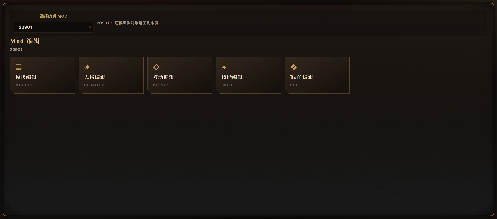

# The Lethe Workbench · 边狱工作台

面向《边狱公司》私服 **Lethe** 的 Mod 编辑器：单文件桌面程序，内置后端与前端，不需要额外装 Node。

当前版本：**v0.9.19**（2026-11-09）



## 能做什么

- **Mod 管理**：列表拖动排序、启用/禁用、备份与版本回滚、永久删除（含冷静期）、DLL 管理
- **人格编辑**：立绘 / 稀有度 / 血量 / 抗性 / 混乱阈值 / 技能与守备 / 被动分档 / 词条 / 源码页
- **技能编辑**：预览卡、基础信息、硬币、描述、置入区（模块块 / 未识别块 / 游戏内置脚本块）
- **被动 / Buff 编辑**：条件（拥有 / 共鸣）、脚本置入、描述、文件字段
- **模块编辑**：Scratch 式积木画布（时点帽 / 遍历 / IF·IFNOT / 效果 / 获取 / 值块），实时输出 Modular 代码
- **镜牢编辑**：卡包 / 饰品 / 战斗 / 敌人 / 普通敌人 / 敌人部位 六张表，含挑选器与批量落地

## 下载

到 [Releases](https://github.com/Eightfeather/LetheCreatorWorkshop/releases) 下载 `TheLetheWorkbench.exe`（约 54 MB），双击即用。

运行环境：Windows 10/11 x64 + .NET Framework 4.8 + WebView2 Runtime（Win11 自带；Win10 一般随 Edge 已装）。

## 第一次使用

1. 启动后若没自动找到私服，在设置里填 `…\BepInEx\plugins\Lethe`（或点「深度扫描」）；
2. 底栏进入「Mod 管理」，点「创建 Mod」；
3. 进「Mod 编辑」→ 人格编辑 → 选罪人 → ＋新建人格；
4. 技能 / 被动 / Buff 各自编辑，模块编辑里拖积木生成脚本；
5. 保存后进游戏验证。

> 编辑器运行期数据写在 `%LOCALAPPDATA%\LetheWorkbench\` 与 `<私服根>\LCW\`；
> 删掉 `%LOCALAPPDATA%\LetheWorkbench\` 等于恢复出厂设置。

## 从源码构建

需要 Node ≥ 18.17、.NET SDK 6+、.NET Framework 4.8、WebView2 Runtime。

```powershell
cd 开发资料
npm install
npm test
npm run build:server
npm run build:app        # 产物：dist\app\TheLetheWorkbench.exe，并自动复制到仓库根
```

首次接手请读 **[docs/22-接手指南.md](docs/22-接手指南.md)**（环境、构建链、调试、常见坑）。

## 文档

| 文档 | 说明 |
| --- | --- |
| [22-接手指南](docs/22-接手指南.md) | 从零跑起来、开发循环、CDP 调试、代码地图 |
| [21-编辑器功能大纲](docs/21-编辑器功能大纲-当前版本.md) | 产品视角的功能清单 |
| [03-数据契约](docs/03-数据契约.md) | Mod 文件格式与字段 |
| [04-验证记录](docs/04-验证记录.md) | 按版本记录的改动点与实测数据（检索用） |
| [23-已知问题与待办](docs/23-已知问题与待办.md) | 用户视角的未修项与设想 |
| [24-版本号与发布约定](docs/24-版本号与发布约定.md) | 版本规则、发版流程 |
| [CHANGELOG](docs/CHANGELOG.md) | 面向使用者的更新说明 |

## 许可与声明

本项目为私服 Lethe 的社区工具，与 Project Moon 无关；未包含游戏本体资源（`game.ttf` 为运行所需的
界面字体，随程序内嵌，来源为游戏本地汉化包）。请自行确认在所在地区的合法使用方式。
